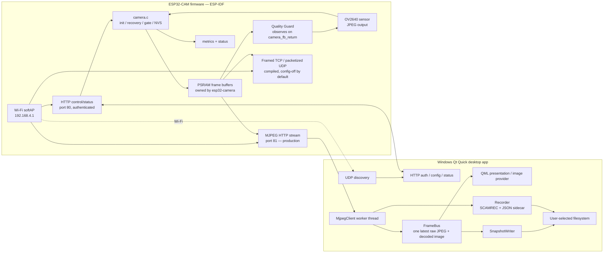

# Sorting Camera — Industrial Product Status Audit

**Audit date:** 2026-11-18  
**Scope:** Read-only audit of the local checkout at `C:\Users\Alireza\Desktop\Sorting_Camera`.  
**Allowed filesystem change:** this report and its new parent directory only. No build, test, flash, benchmark, or hardware action was run for this audit.

## Evidence labels

- **Verified** — directly read from the current source, Git metadata, a local artifact, or a recorded result with inspectable content.
- **Partially verified** — some evidence exists, but the production behavior or provenance is incomplete.
- **Historical** — stated in an existing report/log or the supplied audit context, but not re-executed in this read-only audit.
- **Inferred** — technically supported interpretation, not directly demonstrated by an execution.
- **Unverified** — evidence is absent or insufficient.
- **Risk** — a possible adverse outcome supported by a code path or missing release evidence; not necessarily a reproduced defect.

Line references below are to the checked local files. Generated build outputs and result JSONs are treated as evidence only for the build/run they describe; their directory names alone do not prove provenance.

## A. Executive Summary

- **Verified:** `HEAD` is `79b3b49eba3978ced4346d74d83c75b1d44ec7c2` (`firmware: add quality guard (A2b)`), the intended A2b freeze commit; its parent is `54a27ae117fc1474959f8e3b547057a8cc2c182e`.
- **Verified:** the current checkout is `master`, four commits ahead of `origin/master`, with three modified tracked files and many untracked benchmark results plus two SCAMREC converter files. No staged changes were reported.
- **Verified:** the A2b Quality Guard source is committed. `quality_guard.c` implements requested/effective JPEG quality separation, raise/cooldown, low-frame hold and stepback, and refusal rollback; the host test compiles this same C source.
- **Verified:** all identified frame consumers in the production code return buffers through `camera_fb_return()`. That wrapper observes delivered frame sizes and invokes the guard under `s_cam_mutex`; frames discarded within the camera driver cannot trigger the guard.
- **Confirmed code defect / release risk:** `camera_apply_config()`'s `only_quality` branch calls the sensor before acquiring `s_cam_mutex` and ignores the sensor return value, then reports and saves the requested value and resets the guard. This bypasses the lifecycle exclusion used elsewhere and can make reported/effective quality disagree with the sensor if the write is refused. See [camera.c](../../firmware/esp32_cam_stream/main/camera.c#L689).
- **Partially verified:** Quality Guard host tests cover state-machine behavior, but they do not establish camera integration, locking, gate-closed/driver-down behavior, or OV2640 response. The test executable present in `desktop/build-qtcreator` predates the freeze commit; this audit did not run it.
- **Unverified:** no hardware run demonstrates non-zero Quality Guard raise and stepback counters on production P firmware. The 2026-11-11 qg-trigger is a valid 90-second **netbench** measurement but its p95 frame size is 99.3 KiB, below the 128 KiB raise threshold. The poll log ends before the run starts, so it is not a guard trigger result.
- **Verified artifact identity:** `build-p-release`'s BIN, ELF, bootloader and partition-table hashes match the historical checkpoints provided in the request. Config and object timestamps support that this was built after the freeze commit, but no build log or embedded source commit proves exact source provenance.
- **Partially verified:** historical measurements demonstrate useful profiles (for example SVGA/q12 at 20 MHz around 24.5 fps on bench firmware), but HD runs around 11 fps do not meet the generic 15 fps target. Bench firmware measurements do not prove production P behavior.
- **Verified:** production video currently ships over HTTP multipart MJPEG. TCP and UDP frame transport source is compiled but defaults off; the earlier TCP-primary ADR was not implemented. Discovery is UDP broadcast; the camera softAP/fixed `192.168.4.1` topology is documented and matches the supplied current project instructions.
- **Verified:** desktop code is Qt Quick/C++ with HTTP MJPEG reception, bounded latest-frame delivery, snapshot and SCAMREC recording. Snapshot and recorder source retain the received JPEG payload; host tests cover byte equality. Current live-device tests were not run.
- **Unverified / release gate:** no actual industrial HMI model, OS, CPU architecture, or cross-compilation toolchain is specified. Windows x64 packaging exists, but does not establish suitability for an embedded HMI. Non-Windows persistent credential storage is unsupported by the current `CredentialStore` design.
- **Not release-ready for industrial deployment or unattended operation:** the quality-only write path needs correction and regression coverage; P firmware needs production-hardware acceptance, recovery and a >=60-minute soak; the HMI and installation target must be decided. No release archives are present in `dist`.
- **Current suitability:** appropriate for continued development and controlled engineering hardware testing. A Windows university demonstration is plausible using the documented setup, but not re-certified by this audit. It is not yet an evidenced release candidate for the intended industrial target, nor suitable to claim long-term unattended readiness.

## B. Current Repository State

| Item | Current finding |
|---|---|
| Branch / HEAD | `master`, `79b3b49eba3978ced4346d74d83c75b1d44ec7c2` |
| Parent | `54a27ae117fc1474959f8e3b547057a8cc2c182e` |
| Remote relation | `master...origin/master [ahead 4]` |
| A2b freeze | **Verified:** HEAD equals the named freeze commit exactly. `git log` shows the A2b commit immediately above its parent. |
| Staged changes | None reported by `git status --short --branch`. |
| Modified tracked files | `.gitignore`, `scripts/idf-env.ps1`, `tests/tst_recorder.cpp`. Firmware production source is not modified in the working tree. |
| Untracked files | Numerous `benchmarks/results/*` JSON/Markdown/sample files from October/November; `tools/scamrec_to_mp4.py`; `tools/Run_Scamrec_to_MP4.bat`. These are not part of the frozen commit. |
| Build directories | Desktop: `desktop/build`, `desktop/build-baseline`, `desktop/build-qtcreator`. Firmware: `build`, `build-bufa`, `build-bufb`, `build-bufc`, `build-nb`, `build-nbb`, `build-nc`, `build-ncb`, `build-ncbufb`, `build-ncw`, `build-p`, `build-p-release`, `build-pb`. These are ignored/generated state. |
| Requested report path before audit | Absent. No existing report was overwritten. |

### Relevant current source hashes (SHA-256)

| File | SHA-256 |
|---|---|
| `firmware/esp32_cam_stream/main/camera.c` | `BF92425B5A741D753AF073D1DB7FA58580FA596B3699C6519F6D5415AC2199AD` |
| `firmware/esp32_cam_stream/main/quality_guard.c` | `70A6162D43A7585AE99F1E8FF004D77A1635FBD9CA8CB5A8B07F5091D321B16E` |
| `firmware/esp32_cam_stream/main/quality_guard.h` | `6724D82B6A2DE9D2BE974A99DA0B6346C8D6F625EC9FD6B50180FCE286779B21` |
| `firmware/esp32_cam_stream/main/app.h` | `D6983809E027982EA19A67D2BC32DCE67A1C8935378828F66D4C1DC7A5329FA8` |
| `firmware/esp32_cam_stream/main/http_servers.c` | `DFFED6CFB9F461DC34B5803770508D4355672D88BBD578A96DCAC7B40768755F` |
| `tests/tst_qualityguard.cpp` | `DF95FA550B09DAF9E9537B5CDA922B3F61D0A541AACB55EFDE22729493E8F4C2` |
| Working `tests/tst_recorder.cpp` | `42A4B4B23F15B544D6A9DF9444FC3640DE369F317936AFBD25218CA206074B6B` |

### `tests/tst_recorder.cpp` discrepancy

The commit message says this test was intentionally excluded from the A2b freeze, but `git show HEAD:tests/tst_recorder.cpp` confirms the committed file already contains the `stopRacingTheFramePathKeepsContainerAndIndexInAgreement()` stress test and its `JoinAll` cleanup. The current working diff is narrower: it adds `<utility>` and uses `std::as_const`, and makes sidecar-file opening failure explicit in the test. These changes are sensible test hardening, not production changes; they are not required for the committed test to exist or compile. Keep the local delta separate for review and do not stage it automatically. Historical D3 results that included a modified version cannot be mapped to this exact current test content from the available run record.

## C. Actual System Architecture



**Ownership and flow:** the camera driver owns each `camera_fb_t` until the application fetches it through `camera_fb_get()`. A consumer holds it while sending/serving and returns it using `camera_fb_return()`, where the size is copied before the driver regains ownership. The production MJPEG stream and snapshot handler use that wrapper. The benchmark camera loop also uses it. The alternate frame transport code routes its TCP and UDP frames through it as well, but is non-production while `CONFIG_SORTING_CAM_FRAME_TRANSPORT` is off. The Quality Guard runs after the buffer is returned, under the camera mutex, and can apply a sensor quality change for subsequent frames.

On the PC, the networking/parser worker emits JPEG frames to `FrameBus`; decoding/render integration is in the application pipeline, while QML presents the latest image. The bus is bounded/latest-frame-oriented. Snapshot and recording paths take the original JPEG bytes and write them without re-encoding. The viewer and file operations are separate from firmware frame-buffer ownership.

The current shipped video path is HTTP multipart MJPEG, not the custom TCP/UDP framed paths. `docs/architecture.md` and `docs/protocol.md` explicitly record that ADR-0007's earlier TCP-primary choice was not implemented; the app and firmware currently use HTTP MJPEG for video.

## D. Subsystem Status Matrix

| Subsystem | Implementation status | Test / recorded evidence | Hardware evidence | Remaining work | Confidence |
|---|---|---|---|---|---|
| SoftAP, addressing, discovery | Implemented: AP, fixed `192.168.4.1`, UDP broadcast discovery | `tst_discovery`; ADR-0006; docs | Historical device status and benchmark records show the AP profile | Confirm production AP credentials/channel and HMI network integration | High for source; medium at current hardware state |
| Sensor initialization/config | Implemented: OV2640 defaults, persistent control state, restore after init/recovery; quality/resolution/XCLK validation | `camera.c`, `camera_control.c`, config contract smoke, host Qt suites | Historical camera matrix/profile runs used benchmark firmware | Exercise control restoration, write failures, DCW and profile changes on P | Medium |
| Frame ownership / teardown | Implemented mutex, drain gate, bounded wait and common return wrapper | Source-level call-path inspection; historical recovery notes | Prior streaming and reconnect tests are historical and not P validation | Verify recovery, client timeout and concurrent snapshot/config on P | Medium-high for source structure |
| Quality Guard | Present in A2b; thresholds and state machine match specified design | `tst_qualityguard` compiles production `quality_guard.c`; target exists | No valid non-zero action observation found | Fix `only_quality`; deterministic host suite on current checkout; P raise/stepback hardware acceptance | Medium for state machine; low for integration |
| Production video | HTTP MJPEG over port 81 | `tst_capture` fake-server/parser coverage; protocol docs | Many historical measurements; qg run was netbench, not P | Production-P smoke and recovery; test disconnect/backpressure and multi-client expectations | Medium |
| TCP / UDP video | Implemented as optional `frame_transport.c` | Protocol/benchmark tools and historical network measurements | Historical benchmark firmware runs only | Not in current v1 product path; keep disabled unless owner reopens scope | High for source/config, low for product inclusion |
| Auth/control/status | HTTP control on port 80; challenge-response and bearer session; status reports camera/guard metrics | `tst_authclient`, `tst_credentialstore`, `tst_devicestatus`, config smoke; source | Live security tests remain documented as Phase 8 | Validate expiry, replay, lockout/backoff on actual device; clarify provisioning | Medium-high for host behavior, low for device validation |
| Desktop pipeline/UI | Qt 6.11.2 / C++17 / Qt Quick; discovery, device registry, status, settings, notifications, diagnostics, reconnect | 17 CTest targets currently registered; historic reports describe suites, but no current passing CTest log was found | Windows dev build exists; no HMI run | Fresh configured build and UI checks on the selected HMI/OS/architecture | Medium |
| Snapshot/SCAMREC | Exact JPEG snapshot and SCAMREC frame records with sidecar/index recovery | `tst_capture`, `tst_recorder` cover byte identity, truncation and indexing; local recorder test delta | Live-device byte-identity suite not run here | Disk-full/permission behavior on target; long record/recovery on target filesystem | Medium-high host, low target |
| SCAMREC-to-MP4 tool | Two untracked files present; converter reads SCAMREC v1 + sidecar, verifies frame structure, invokes external FFmpeg | Source inspected; no converter tests/result evidence | Not applicable | Decide whether to ship; add compatibility tests and document Python/FFmpeg/libx264 requirements if retained | Low-medium |
| Packaging/licensing | Scripts/documentation describe Windows portable zip and firmware zip; no installer in v1 | `scripts/package-release.ps1`, `docs/deployment.md`, `docs/licensing.md`; prior packaging claim in remediation log | No current `dist` directory/artifact found | Produce release archives only after accepted source and CI; resolve target OS and update story | Medium for scripts, no current release artifact |
| Industrial HMI / unattended behavior | Not specified | Windows implementation and deployment docs only | No HMI hardware or long-duration product validation identified | Owner must specify HMI and operating conditions; then port/package and soak | Unverified |

## E. Quality Guard Acceptance Report

The A2b implementation is **conditionally accepted as a host-testable state machine, not accepted as production behavior**. The core source is present and integrated, but one production configuration path violates the same synchronization and refusal-handling rules used by the guard path, and no hardware test has shown a raise and stepback on production firmware.

| Acceptance criterion | Current evidence | Status |
|---|---|---|
| Guard implementation present | `quality_guard.c/.h`, compiled in `main/CMakeLists.txt`; A2b is HEAD | Verified |
| JPEG quality-number direction | Raise does `effective += 2`; higher OV2640 JPEG quality number means more compression/smaller JPEG, not better image quality | Verified from documented driver semantics/source; actual visual tradeoff still requires hardware |
| Production frame return integration | `camera_fb_return()` copies `fb->len`, returns the buffer, decrements held count, then calls `camera_guard_step()` while mutex is held (`camera.c:612–675`) | Verified |
| All production consumers use wrapper | MJPEG handler, snapshot handler, and bench loop call `camera_fb_return`; `frame_transport.c` TCP/UDP paths also do. Only the MJPEG and snapshot paths are production by default | Verified by source search |
| Budget / thresholds | `CONFIG_CAMERA_JPEG_MODE_FRAME_SIZE=262144`; raise at >=50% = 131072 B; low is `<35%` = below 91,750.4 B (integer comparison); 250 ms raise cooldown, 10 s low hold, 5 s stepback interval | Verified in defaults and `quality_guard.h` |
| Requested/effective separation | `s_quality` remains requested/persisted; guard `effective` tracks applied value; status exposes both | Verified in source; setter error caveat below |
| Raise and stepback algorithm | +2 quality steps under cap after cooldown; sustained low condition triggers one stepback and then 5 s spacing; `QG_DEFAULT_CAP=40`, bounded against requested/floor | Verified in state machine and unit test source |
| Sensor refusal from guard | `quality_guard_sensor_refused()` restores attempted state/counter and effective value; tests cover refusal and cooldown/hysteresis state | Verified in code/test source; actual sensor refusal untested |
| `only_quality` sensor refusal | `camera.c:743–755` ignores `sensor->set_quality()` result, then commits `s_quality`, resets guard and returns success | **Confirmed defect**: software can claim/save a value the sensor rejected |
| Sensor-write synchronization | Guard writes while holding `s_cam_mutex`; full config/recovery paths use the same mutex. `only_quality` executes `esp_camera_sensor_get()` and `set_quality()` before taking it | **Confirmed synchronization gap**; runtime collision not reproduced. Config endpoint does not take an outer camera lock for this call (`http_servers.c:377–383`) |
| Gate closed / driver down | Guard step checks `!s_driver_up || s_gate_closed`; under wrapper mutex this avoids guard writes during teardown. Driver-down status returns requested quality | Verified by source; no dedicated integration test |
| Reset and counters | `camera_guard_reset()` reinitializes state on camera bring-up/config and restores raise/stepback counters. Counters are RAM-only and reset on power cycle; user quality is persisted separately in NVS | Verified by source; power-cycle behavior inferred from static storage, not measured |
| Status API | `http_servers.c` emits requested/effective and guard counters; `min_free_internal` is included in device status | Verified in source |
| Current hardware trigger | qg-trigger result: netbench camera enabled, 90.064 s run, SVGA/q2/x18, 1,343 frames, p95 101,658 B (99.3 KiB), no errors; p95 <131,072 B. `qg-poll.log` was 13:15:04–13:16:14 local; run artifact starts 13:17:47. | **Inconclusive for guard**; no action could be established from this poll/run pairing |
| qg-trigger2/corrected poll | Search of project and Desktop/Documents/Temp found no `qg-poll2.log`, qg-trigger2 result, or later trigger log. | Unverified; no corrected result available |
| P firmware behavior | The trigger was `fw: netbench`; bench path differs from P production task/HTTP path | Not established |

**Acceptance conclusion:** A2b core logic passes the design-level source review, but P firmware acceptance remains open. Fix and test the quality-only apply path first. Then run a deliberate hardware trigger on production P with before/after status samples timestamped across the exact measurement window. If a natural scene cannot exceed 128 KiB at an accepted profile, an isolated test-only threshold may be considered only after proving the test firmware uses a separate build directory/config and cannot replace the production P artifact. Do not reduce the production frame budget to force a trigger.

## F. Build and Artifact Provenance

### Current build directory evidence

All inspected generated sdkconfigs set target `esp32` and frame budget 262,144 bytes. CMake cache records show Ninja, per-directory `SDKCONFIG` paths, and defaults sources for the requested P/NB/NCBUFB variants. These establish current directory configuration, but do not by themselves prove the exact binary source revision.

| Variant / directory | Purpose / defaults in CMake cache | BIN bytes | ELF bytes | Current provenance assessment |
|---|---|---:|---:|---|
| P `build-p` | Production; `sdkconfig.defaults` | 1,022,592 | 9,783,352 | Present; generated metadata identifies ESP32/Ninja; no source commit stamp. |
| P release `build-p-release` | Production; `sdkconfig.defaults` | 1,022,592 | 9,783,360 | BIN/ELF/bootloader/partition hashes match supplied historical checkpoints. Source `camera.c` timestamp 2026-11-07 13:02 and its object 2026-11-10 02:00; ELF/BIN completed 2026-11-10 02:00, after freeze commit. This is strong corroboration, not a source-commit attestation. |
| NB `build-nb` | Bench, no camera; `sdkconfig.defaults;sdkconfig.bench-nocam.defaults` | 1,024,848 | 9,808,056 | Present, ESP32/Ninja; bench binary must not be treated as production. |
| NCBUFB `build-ncbufb` | Camera-on bench + B-buffer; `sdkconfig.defaults;sdkconfig.bench-cam.defaults;sdkconfig.buf-b.defaults` | 1,025,872 | 9,808,516 | Present, ESP32/Ninja; used by historical qg-trigger experiment family, but result identity says `netbench`. |
| Other variants | `build-bufa/b/c`, `build-nbb`, `build-nc`, `build-ncb`, `build-ncw`, `build-pb` | Present; size varies | Present | Historical and exploratory benchmark/config variants; see each cache/defaults file before use. |

### P release artifact hashes and memory figures

| Artifact | SHA-256 | Current bytes where inspected |
|---|---|---:|
| `build-p-release/esp32_cam_stream.bin` | `54B06D394CA17FE3AEE2D7F4560B3EBDA272AF2A1C95DC1D4F7CEC015D06A023` | 1,022,592 |
| `build-p-release/esp32_cam_stream.elf` | `CB9C386E30BC200B1BF0F8704C28CF33D348405E36177BFD98547F7E5C51A2DD` | 9,783,360 |
| `build-p-release/bootloader/bootloader.bin` | `A31DC1E04876E6F3FF3652ECFFD0AC04831BCC0EFD552730EAF8BC80C490CBA8` | — |
| `build-p-release/partition_table/partition-table.bin` | `5E71C3C890E04714DAA03B21A0D23953A2DADF9FDF15EEC02B886F7B6E9F8C81` | — |

The hashes exactly match the historical P release-candidate values supplied with the request. Associated historical size output reports IRAM 121,147 / 131,072 bytes (9,925 free), DRAM 48,272 bytes, flash code 713,501 bytes, frame budget 262,144 bytes. The release app BIN length is `0xF9A80` = **1,022,592 bytes**; the supplied historical context paired that hex with 1,022,472, which is an arithmetic mismatch. The measured current file length and hex agree at 1,022,592. Current exact flash/partition headroom and fresh `idf.py size` output were not recomputed.

### Toolchain and dependencies

- Project-pinned ESP-IDF: v5.5.4 (ADR-0005); historical build report identifies Xtensa GCC 14.2.0, IDF CMake 3.30.2, esptool 4.12.0, Python 3.13.15.
- Firmware dependencies lock `espressif/esp32-camera` 2.1.7 and `esp_jpeg` 1.3.1. Do not update casually because the measured record is tied to them.
- Desktop docs pin Qt 6.11.2 MinGW 64-bit, CMake 3.30.5, Ninja 1.12.1, MinGW 13.1.0. Existing `desktop/build-qtcreator` is an older configured build; executable timestamp 2026-10-31. It is not proof of a clean current release build.
- `sdkconfig.defaults` contains the CPU/flash/Wi-Fi/IRAM tuning block with comments describing parts as unmeasured on the production release path. Bench builds exercise related settings, but the P image has no local P-hardware acceptance evidence.
- No `dist` output was found. No currently packaged app/firmware release or release manifest can be assessed.

## G. Test and Hardware Validation Matrix

| Evidence class | What exists | Current interpretation / limits |
|---|---|---|
| Firmware host test | `tests/tst_qualityguard.cpp` registered as `tst_qualityguard`; test CMake states it compiles production `quality_guard.c` | Strong for pure guard rules. Does not test FreeRTOS mutex/gate, camera driver, OV2640 or HTTP status integration. |
| Desktop host tests | `tests/CMakeLists.txt` registers 17 Qt Test targets: auth, credential store, discovery, session state, user prefs, device status, registry, profile engine, diagnostics, notifications, recorder, capture, config-write sequence, capabilities, quality guard, app metrics, accessibility | Source suite coverage is broad. `docs/testing.md` and README still say 16 suites in places, so docs lag the 17-target tree. Existing binaries are not execution evidence. |
| Latest CTest record inspected | `desktop/build-qtcreator/Testing/Temporary/LastTest.log` contains only start/end lines for 2026-11-18; no test cases/results. | No current CTest pass was established. Do not call the present tree fully tested. |
| Historical D3-C | Supplied historical context reports 17/17 passed in ~84.21 s, including local recorder modification | Historical only; exact run output/provenance not present in current report artifacts. `docs/audits/PHASE7_REMEDIATION.md` says earlier phases had suites not yet run, and later docs have stale counts. Re-run after code correction using a fresh build directory. |
| Config smoke | `tools/config_contract_smoke.py` plus fake camera; `scripts/ci.ps1` invokes it | Implemented hermetic contract check; no execution was performed for this audit. A fake camera does not establish actual ESP-IDF HTTP behavior. |
| Benchmark firmware | Numerous `benchmarks/results/*.json` and summaries, including 120 s link/camera runs, 300 s bench soak, buffer matrices, and qg-trigger | Valid historical bench evidence for the exact recorded config; most files are untracked. It does not prove production P behavior or current HMI decode/render performance. |
| qg-trigger | `phase2-cam-qg-trigger-20261111-131747.json`, `cam-qg-trigger-svga-q2-20261111-131923-707047.json`, and a sample JPEG | Valid 90 s netbench capture: 14.90 fps, ~12.08 Mbps, 100% JPEG end markers; frame p95 101,658 B below raise threshold. No guard action evidence. |
| Poll log | `C:\Users\Alireza\Desktop\claude reports\11-11-2026\qg-poll.log`, timestamp range 13:15:04–13:16:14 on 2026-11-11 | It samples quality 16/effective 16, counters 0 during a period before the benchmark run began around 13:17:47. It cannot establish post-run guard state. No qg-poll2/trigger2 file was found in searched project/Desktop/Documents/Temp locations. |
| Production P hardware | No matching P firmware smoke, guard trigger, controlled recovery, or >=60-minute soak artifact identified | Missing release validation. Bench firmware results must not be substituted. |
| Qt live-device coverage | `docs/testing.md` describes optional live auth/discovery/capture tests guarded by environment variables | Not run in this audit; historical notes say Phase 8 live security work remains outstanding. |
| SCAMREC converter | Source only, untracked; no unit tests or compatibility run found | Compatibility appears structurally aligned with SCAMREC v1 but is not validated against a current produced recording or FFmpeg build. |

Historical performance context from `docs/benchmark-results.md`: SVGA/q12 at 20 MHz had 3×300 s benchmark runs around 24.5 fps; HD/q12 at 18–20 MHz was around 11–12.5 fps. These are benchmark firmware/recorded setups, not production P release acceptance. The target in docs is minimum 15 fps and preferred 20+, with quality prioritized over FPS; the documented HD profile has a provisional lower floor, so its exception must be part of the product operator requirement.

## H. Risk Register

| ID | Priority | Subsystem | Evidence and impact | Classification | Recommended action / acceptance | Code change? | Test / hardware? |
|---|---|---|---|---|---|---|---|
| R-01 | P0 for industrial deployment | HMI / release target | No HMI model, OS, architecture or deployment toolchain is established in project source/docs. A Windows x64 zip cannot be asserted to run on an unspecified target. | Confirmed missing product requirement; blocks target-specific release | Owner selects exact HMI/OS/CPU/display/input/network/storage, then configure/build/package on that target and pass install/startup acceptance. | Not until target is selected | Target hardware required |
| R-02 | P1 | Firmware camera config / Quality Guard | `camera.c:740–755`: only-quality path writes outside `s_cam_mutex` and ignores setter result, then updates requested state and guard. This can race guard/recovery/config writes and falsely report success after a rejected sensor write. | Confirmed code defect; runtime impact is a risk, not reproduced | Serialize the sensor write with lifecycle/guard synchronization; only update/persist requested/effective state after successful setter; add refusal/concurrency regression coverage. Pass when failed write leaves sensor/software state coherent and concurrent teardown/config cannot overlap the write. | Yes | Host/unit or mocked seam plus P hardware config test |
| R-03 | P1 | Production firmware acceptance | P artifact is present and hash-verified, but qg test and most matrix evidence are `netbench`; no P flash/smoke/recovery record or production soak found. | Missing hardware evidence | Flash only after accepted clean P build; run status/config/live stream, snapshot, recovery/disconnect and >=60-minute soak. Pass on stable uptime/reset reason, non-increasing recovery/failure counters, active delivery, no unexpected send failures, live video at end, and recorded RAM trend. Derive RAM floor from measured device margin; the proposed 50 KB is not validated. | No, unless failures reveal a defect | Yes, production camera and PC |
| R-04 | P1 | Quality Guard evidence | No validated guard raise/stepback on hardware. qg-trigger's p95 101,658 B was below 131,072 B; poll ended before the test and `fw` is netbench. | Missing/inconclusive validation, not a bug | Correct quality-only path first; build isolated P; gather timestamp-aligned status/logs before/during/after a scene/profile that yields delivered frames >=131,072 B, then sustained low frames and stepback. Pass when counters/effective value/logs agree and image stream remains valid. | After R-02 fix | Yes |
| R-05 | P1 | Credentials / target platform | Windows `CredentialStore` uses OS-protected storage (DPAPI); non-Windows persistent credential storage is reported unsupported. | Confirmed portability boundary; target impact unknown | After target decision, prove secure storage and provisioning on that OS; never silently persist plaintext. Pass when credential storage behavior and failure mode are tested on target. | Possibly | Target integration test |
| R-06 | P1 | Network/product operation | SoftAP is fixed to `192.168.4.1`; joining camera network disconnects PC from internet per deployment docs. Video stream is intentionally unauthenticated and unencrypted; current design assumes trusted local AP. | Verified design tradeoff; suitability depends on deployment | Confirm direct AP is acceptable for the machine/HMI and that WPA2 credentials are per-unit provisioned and managed. If exposure changes, reopen security ADR. Pass with documented physical/network threat boundary and recovery behavior. | No unless requirement changes | Hardware/RF check |
| R-07 | P2 | Tests/docs | Test CMake registers 17 suites while README/testing docs mention 16 in places; current local CTest log has no results. | Documentation and evidence gap | Run fresh `scripts\ci.ps1` after R-02; update test-count docs only when release work is authorized. Pass: clean configure/build, 17 suites green, smoke green, captured log and exact commit. | Docs likely | Host |
| R-08 | P2 | Local source hygiene / test provenance | `.gitignore`, `scripts/idf-env.ps1`, and `tst_recorder.cpp` modified; many raw benchmark files and converter utility untracked. D3 record included an uncommitted recorder version. | Confirmed provenance/handoff risk, not product defect | Keep separate; review content and decide what is intentional before any freeze/package. Benchmark artifacts should retain metadata and never be mistaken as committed evidence. Pass: release source snapshot documented clean or explicitly dirty with reviewed included files. | Decision / possible test-only | Host review |
| R-09 | P2 | Long-term operation / recording | Existing soak docs defer >=1 h integrated run; disk-full, power-loss recording recovery and HMI filesystem limits are not established on target. | Missing evidence | Integrated soak with record start/stop, file growth, disk-full handling, reconnect and shutdown; pass objective counters/storage integrity and no unbounded memory growth. | If tests reveal issues | HMI + camera |
| R-10 | P3 | Converter distribution | MP4 utility and batch launcher are untracked and require Python plus external FFmpeg/libx264. No compatibility test or package integration. | Optional tool maturity/distribution issue | Decide whether to maintain/distribute; if retained, add converter tests using a fixture and document dependencies/license/codec behavior. | Only if retained | Host, FFmpeg |

## I. Remaining Product Requirements

### Unknown and owner-dependent

- Exact HMI make/model and its supported OS release, CPU architecture, RAM, GPU/display path and touch/input devices.
- Whether the final target is Windows x64 or another platform; cross-compiler and supported Qt 6.11 deployment/runtime on that platform.
- Startup after power restoration, service/autologin behavior, shutdown policy and recovery when camera/AP is unavailable.
- Required frame rate/resolution/visual quality at the real rice belt speed, working distance, lighting, lens and motion blur envelope. Current HD FPS target exception is provisional in project docs.
- Camera board/module revision, power supply current/transient margin, cable length, camera mounting, enclosure/thermal/EMI conditions and RF layout.
- Whether the AP direct-link topology is suitable for the HMI and operator workflow; softAP is the current locked baseline, but the industrial machine requirements are unknown.
- Per-unit provisioning process for AP password and device control password, credential rotation/recovery and physical access model.
- Target storage volume, retention, disk-full behavior, filesystem durability, log retention and recording recovery requirements.
- Required installer/OTA/update and rollback process. Current v1 docs describe portable Windows zip and wired firmware flashing; no installer or OTA is in scope.
- Whether the SCAMREC-to-MP4 converter belongs in the supported product distribution.

### Implemented but platform-specific or boundary-limited

- Current Windows Qt build uses Qt 6.11.2, MinGW 13.1 and LGPL-compatible dynamic modules. Windows DPAPI protects saved control credentials. A non-Windows build would need platform validation and secure credential storage integration before use.
- Current release documentation says the viewer zip is portable on Windows 10+ x64; this is a documented deployment claim, not proof for an embedded HMI.
- Wi-Fi stream has no TLS and stream endpoint has no auth token by deliberate design; it is acceptable only within the documented trusted network boundary.

## J. Recommended Finalization Roadmap

The shortest defensible sequence is below. Existing benchmark matrices should not be repeated unless the changed production path or target makes them relevant.

| Phase / dependency | Purpose and scope | Actions and later commands/tests | Source changes | Hardware | Evidence and pass gate |
|---|---|---|---|---|---|
| 0. Freeze and provenance | Establish exact release source/config and resolve the local dirty tree. Files: Git status, `.gitignore`, `scripts/idf-env.ps1`, `tests/tst_recorder.cpp`, untracked results/tools, P build metadata. | Review each local delta; archive/retain raw results with metadata; record chosen source tree and hashes; no destructive cleanup. Read-only commands: `git status --short --branch`, `git diff`, `git log`, `Get-FileHash`. | No production change expected | None | Accepted source snapshot has reviewed inclusions, no credentials, and a traceable commit; any dirty source is explicitly listed. Depends on owner/release-source decision. |
| 1. Correct quality-only apply (0) | Close R-02. `camera.c`, `quality_guard.c`, `tests/tst_qualityguard.cpp` or a focused camera seam test. | Change setter handling and lock ordering; test setter success/refusal, requested/effective rollback, guard-vs-config serialization, and reset semantics. Run `cmake --build desktop\build-qtcreator` and `ctest --test-dir desktop\build-qtcreator --output-on-failure` only after implementation; prefer fresh build directory for final gate. | Expected | Camera later | Setter refusal must not return success/save mismatched state; frame return/guard and config/recovery cannot concurrently write sensor; test suite green. |
| 2. Quality Guard host gate (1) | Establish deterministic rule coverage on accepted source. | Run `tst_qualityguard` and full CTest; inspect logs, confirm test compiles current production `.c`, record commit and test duration. | Tests only if gaps | None | Threshold boundaries, cooldown, low hold, stepback cadence, cap/floor, refusal rollback all pass. Host result explicitly does not claim hardware behavior. |
| 3. Clean production P build (1–2) | Produce reproducible P artifact. Files: `sdkconfig.defaults`, `dependencies.lock`, `scripts/idf-env.ps1`, firmware CMake. | In a new dedicated output dir, source environment with `scripts\idf-env.ps1`; configure the P project using `sdkconfig.defaults`; `idf.py -B build-p-rc -D SDKCONFIG=build-p-rc/sdkconfig -D "SDKCONFIG_DEFAULTS=sdkconfig.defaults" set-target esp32`; then `idf.py -B build-p-rc build`; capture full log and `idf.py -B build-p-rc size`. Do not use a bench dir. | No expected unless build finds issue | None | Exit 0; exact sdkconfig/toolchain/dependency capture; no unreviewed warnings; BIN/ELF/bootloader/partition hashes and size report in release manifest; margin accepted. |
| 4. P smoke + guard acceptance (3) | Validate the actual production firmware. | Flash only the accepted P image using documented `idf.py -p <PORT> flash` / serial monitor. Verify AP, status, login, config, frame stream, JPEG validity, snapshot; collect before/during/after status at aligned timestamps; run scene trigger and wait for low-frame stepback; test setter refusal only if safely inducible. | No unless failures | ESP32-CAM + OV2640, USB serial, Windows PC on AP | `quality_effective`, action counters and logs correspond; requested quality is restored/retained; no reset/corrupt stream; no repeated refusal spin. Never use benchmark image as evidence for P. |
| 5. P recovery + integrated soak (4) | Establish operational reliability. | Exercise disconnect/reconnect, AP client leave/rejoin, capture stall/recovery, config reinit, snapshot and recording start/stop. Then >=60-minute integrated soak at agreed operating profile. Poll status and memory trend, record UART and app logs. | Only if observed defect | Camera, PC/HMI target if available | Uptime continuous, reset reason stable, recovery/failure/send counters meet agreed criteria, frame delivery remains live, internal RAM trend stable with an empirically justified lower bound, recording parses and bytes match. The proposed 50 KB threshold is not a validated safety limit. |
| 6. Target decision + desktop build (may overlap 3–5) | Select HMI and produce a runnable app. Files: `desktop/CMakeLists.txt`, platform-specific `CredentialStore`, QML, `scripts/env.ps1`, deployment docs. | Owner names HMI/OS/architecture. Install matching Qt/compiler/cross-toolchain; configure, build and run 17 CTest suites plus fake-camera contract smoke on that platform; verify plugins/QML imports, network interfaces, display/touch and secure storage. | Platform-specific changes may be required | Actual HMI | App starts on boot as specified; discovers/connects/authenticates; frame display and reconnect work; credentials are stored securely or persistence is explicitly disabled; tests/build/package captured for target. |
| 7. Operator deployment, package, acceptance (5–6) | Deliver traceable install and support materials. | Confirm portable zip vs installer, wired flashing vs future OTA, credential provisioning, machine startup/shutdown, operator controls, troubleshooting, release manifest and checksums. Run `scripts\ci.ps1` and then `scripts\package-release.ps1` only from accepted clean source; verify zip listing and source commit stamp. | Docs/scripts as required | Target HMI and production camera | Manifest includes source commit/dirty state, toolchain, sdkconfig/defaults, dependencies, artifact hashes, test and hardware evidence, installation instructions and known limits. Release gate signed off by owner. |

### Work classification

- **Can proceed immediately without hardware:** review local dirty files; correct and unit-test the `only_quality` branch; align test-count and provenance documentation; fresh host CI after the fix; inspect package script and converter maintenance decision.
- **Requires camera hardware:** production P flash/smoke, Quality Guard non-zero trigger and stepback, sensor refusal where feasible, recovery and integrated soak.
- **Requires HMI target specification:** cross-build, credential-store integration, packaging, startup service, paths, display/touch and deployment runtime.
- **Requires owner decision:** exact target machine/OS/architecture; accepted operating resolution/FPS/quality profile; AP workflow and credential provisioning; whether converter/installer/OTA are in release scope.

## K. Immediate Next Actions

1. Review the three tracked local changes and decide the intended source snapshot; the recorder change is test-only polish on top of an already committed stress test. Do not discard or stage by assumption.
2. Fix `camera_apply_config()`'s `only_quality` sensor write synchronization and return-value handling, then add a regression test before any P firmware acceptance run.
3. Run a fresh host configure/build/CTest/contract smoke after that fix. Capture all output and current commit; the present local CTest log contains no results.
4. Build the clean P image in a dedicated directory and save config, build/size logs and checksums.
5. Decide the HMI platform, then schedule production P guard/recovery/soak validation on that target.

Useful read-only commands for the next audit/release review:

```powershell
git status --short --branch
git log -5 --oneline --decorate
git diff -- .gitignore scripts/idf-env.ps1 tests/tst_recorder.cpp
Get-FileHash firmware\esp32_cam_stream\build-p-release\esp32_cam_stream.bin -Algorithm SHA256
Get-Content firmware\esp32_cam_stream\build-p-release\sdkconfig | Select-String 'IDF_TARGET|CAMERA_JPEG_MODE_FRAME_SIZE|ESPTOOLPY_FLASHFREQ|SPIRAM_SPEED'
```

## L. Open Engineering Decisions

1. What exact HMI, OS version, CPU architecture, display/touch and storage will ship?
2. Which camera operating profile is acceptable for the rice-sorting machine: resolution, visual quality, minimum sustained FPS and permitted HD exception?
3. Is the direct ESP32 softAP workflow acceptable for the HMI and operator, including loss of internet while connected? (The project currently locks softAP as its topology; this asks whether the industrial workflow meets product constraints.)
4. What is the per-unit AP/control-password provisioning and recovery process?
5. Is the SCAMREC-to-MP4 converter a maintained deliverable, and is a Windows portable zip sufficient or is an installer required?
6. What formal duration/environment defines industrial readiness beyond the minimum 60-minute engineering soak, including thermal, EMC/RF, power interruption and file retention conditions?

Decisions that can be made from source alone—current transport, current protocol, current frame ownership, current hashes and current test registration—are recorded above and do not need owner clarification.
